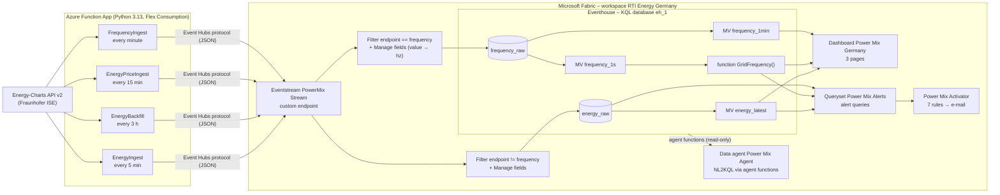

# Power Mix Germany

**From API to Data Agent: Germany's power grid with Real-Time Intelligence in Microsoft Fabric**

A real-time data pipeline for the German power grid built on **Real-Time Intelligence in
Microsoft Fabric**. Azure Functions poll the public Energy-Charts API of Fraunhofer ISE. A Fabric
Eventstream routes the events into an Eventhouse, where the data is kept permanently. A
Real-Time Dashboard, Activator alerts and a Fabric data agent sit on top of the Eventhouse.

```
API → Azure Functions → Eventstream → Eventhouse → Dashboard · Activator · Data Agent
```

| What | Detail |
|---|---|
| Data | Power generation per source, renewable share incl. forecast, cross-border flows, day-ahead prices, grid frequency per second |
| Latency | ~2 min (frequency), 15–90 min (generation data, set by the source), prices for tomorrow from ~13:00 |
| Retention | Permanent (36,500 days), recoverability enabled |
| Fabric workspace | RTI Energy Germany |
| Fabric capacity | Paid **F capacity** (F2 or higher) – **required for the data agent** |
| License of the data | CC BY 4.0 (see [Licenses and attribution](#licenses-and-attribution)) |

---

## Contents

1. [Features](#features)
2. [Architecture](#architecture)
3. [Repository structure](#repository-structure)
4. [Data source: Energy-Charts API](#data-source-energy-charts-api)
5. [Azure Functions](#azure-functions)
6. [Event format](#event-format)
7. [Fabric Eventstream](#fabric-eventstream)
8. [Eventhouse data model](#eventhouse-data-model)
9. [Real-Time Dashboard](#real-time-dashboard)
10. [Activator alerts](#activator-alerts)
11. [Data agent](#data-agent)
12. [Setup from scratch](#setup-from-scratch)
13. [Local development and deployment](#local-development-and-deployment)
14. [Git integration of the Fabric items](#git-integration-of-the-fabric-items)
15. [Data quality and known characteristics](#data-quality-and-known-characteristics)
16. [Monitoring and troubleshooting](#monitoring-and-troubleshooting)
17. [Licenses and attribution](#licenses-and-attribution)

---

## Features

- **Live power mix**: public net generation in Germany per energy source (15-minute values),
  grouped into 10 categories.
- **Traffic light**: Energy-Charts signal (green / yellow / red / grid congestion) and the
  renewable share of the load, including a forecast for the coming hours.
- **Cross-border flows**: physical power exchange with all 11 neighboring countries and the
  net import/export, with a completeness rule for late-reporting countries.
- **Electricity prices**: day-ahead exchange price for the bidding zone DE-LU per
  quarter-hour, for today and – once the auction is published – tomorrow.
- **Grid frequency**: Continental European grid frequency per second, measured in Freiburg,
  plus minute aggregates for long-term analyses.
- **Late corrections handled**: preliminary values are corrected automatically when the
  source publishes newer figures.
- **Seven e-mail alerts**: green power, grid congestion, high export, negative prices
  (now / tomorrow), frequency deviations and pipeline outages.
- **Data agent**: ask questions in natural language (English), e.g. *"When is electricity
  cheapest today?"* or *"How does the price depend on the renewable share?"* – optionally also
  available in Microsoft 365 Copilot (additional license, see [Data agent](#data-agent)).
- **Everything in Git**: function code, KQL scripts and all Fabric items (through Fabric Git
  integration) in one repository.

---

## Architecture



Plain-text version:

```
Energy-Charts API v2 ──> Azure Functions (Python 3.13, Flex Consumption)
                              │  Event Hubs protocol (JSON)
                              ▼
            Fabric Eventstream "PowerMix Stream" (custom endpoint)
                       │ endpoint != "frequency"          │ endpoint == "frequency"
                       ▼                                  ▼
               Eventhouse eh_1: energy_raw        Eventhouse eh_1: frequency_raw
                       │                                  │
               MV energy_latest                   MV frequency_1s / frequency_1min
                       │                          function GridFrequency()
                       └──────────────┬───────────────────┘
                                      ▼
   Dashboard "Power Mix Germany" (3 pages) · "Power Mix Activator" (7 rules)
                                      │  agent functions (read-only)
                                      ▼
                     Data agent "Power Mix Agent"
```

**Design decisions**

| Decision | Reason |
|---|---|
| One event per value (long format) | Works the same for every endpoint and series; new series need no schema change. |
| Append-only raw tables + materialized views | Late corrections are simply sent again; `arg_max(generated_at)` always returns the latest version. Raw history is kept for auditing. |
| One Eventstream, routed by filter | One connection string for all functions; frequency data (86,400 rows/day) is kept separate from the 15-minute data. |
| Backfill function instead of a longer look-back | Keeps the 5-minute runs small and fast while still capturing corrections that arrive hours later. |
| Timer schedules offset by seconds | Avoids parallel requests against the API rate limit (2 requests/min per endpoint). |

---

## Repository structure

```
real-time-intelligence-project-energy/
├── Readme.md                          This file
├── energy-ingest/                     Azure Function App (Python)
│   ├── function_app.py                4 timer-triggered functions
│   ├── requirements.txt               Python dependencies
│   ├── host.json                      Functions host configuration
│   ├── local.settings.json.example    Template for local settings (copy to local.settings.json)
│   ├── .funcignore / .gitignore
│   └── README.md                      Short developer notes (run, deploy)
├── Fabric/
│   ├── data-agent/                    Configuration of the data agent "Power Mix Agent"
│   │   ├── agent_description.md       Description shown to users when publishing (incl. sample questions)
│   │   ├── agent_instructions.md      Agent instructions
│   │   ├── datasource_description.md  Data source description for eh_1 (max. 800 characters)
│   │   ├── datasource_instructions.md Data source instructions for eh_1
│   │   ├── example_queries.kql        20 example queries (readable, with comments)
│   │   └── example_queries.json       The same 20 examples in Fabric's upload format
│   └── kql/                           KQL scripts (setup, dashboard tiles, alerts, agent functions)
│       ├── 01_setup_eventhouse.kql    Table energy_raw, MV energy_latest, policies, checks
│       ├── 02_dashboard_grid_live.kql Dashboard page "Grid Live" (tiles + descriptions)
│       ├── 03_dashboard_prices.kql    Dashboard page "Electricity Prices"
│       ├── 04_grid_frequency.kql      Table frequency_raw, MVs, GridFrequency(), checks, page "Grid Frequency"
│       ├── 05_activator_alerts.kql    Queries and settings of all 7 Activator rules
│       └── 06_data_agent_functions.kql 8 helper functions for the data agent + checks
├── eh_1.Eventhouse/                   ┐
├── PowerMix Stream.Eventstream/       │
├── Power Mix Activator.Reflex/        │ Fabric items – written and read by
├── Power Mix Alerts.KQLQueryset/      │ Fabric Git integration
├── Power Mix Germany.KQLDashboard/    │
├── Power Mix Agent.<type>/            ┘ (data agent – folder name as created by Fabric)
└── .vscode/                           Editor settings
```

### Fabric items

| Item | Type | Purpose |
|---|---|---|
| `eh_1` | Eventhouse / KQL database | Tables, materialized views, function `GridFrequency()` and the 8 agent functions |
| `PowerMix Stream` | Eventstream | Custom endpoint, routing into `energy_raw` and `frequency_raw` |
| `Power Mix Germany` | Real-Time Dashboard | 3 pages: Grid Live, Electricity Prices, Grid Frequency |
| `Power Mix Alerts` | KQL Queryset | The 7 alert queries |
| `Power Mix Activator` | Activator | 7 rules with e-mail actions |
| `Power Mix Agent` | Data agent | Natural-language Q&A over eh_1 (optionally published to Microsoft 365 Copilot). Requires a paid **F capacity**. Its instructions and examples are additionally kept readable in `Fabric/data-agent/` |

`energy-ingest/local.settings.json` contains the connection string and is never committed.
The folders ending in `.Eventhouse`, `.Eventstream`, `.Reflex`, `.KQLQueryset` and
`.KQLDashboard` (and the data agent folder) are managed by Fabric – edit them only as described in
[Git integration of the Fabric items](#git-integration-of-the-fabric-items).

---

## Data source: Energy-Charts API

Base URL: `https://api.energy-charts.info` (API version 2). No key is required.

| Endpoint | Content | Resolution | Time parameters used |
|---|---|---|---|
| `/v2/public_power` | Public net generation per source, load, residual load, renewable share | 15 min, MW | ISO `start`/`end` (UTC) |
| `/v2/signal` | Traffic light (−1…2) and renewable share incl. forecast | 15 min | none (returns today + forecast) |
| `/v2/cbpf` | Cross-border physical flows per neighbor country + sum | 15 min, GW | day format `YYYY-MM-DD` (local time) |
| `/v2/price` | Day-ahead price, bidding zone `bzn=DE-LU` | 15 min, EUR/MWh | day format, today … tomorrow |
| `/v2/frequency` | Grid frequency, region `DE-Freiburg` (currently the only one) | 1 s, Hz | ISO `start`/`end` (UTC), max. 3 days |

**Rate limits**: 2 requests per minute per endpoint (signal: 20/min). HTTP 429 responses
contain a `Retry-After` header. The functions wait up to 60 seconds; longer waits are skipped
until the next run.

**Response format** (v2 envelope, shortened):

```json
{
  "schema_version": "2.0",
  "endpoint": "public_power",
  "country": "de",
  "unit": "MW",
  "generated_at": "2026-10-11T09:30:12+00:00",
  "available_from": "...", "available_until": "...",
  "series": [{ "id": "solar", "name": "Solar", "unit": "MW" }],
  "data": [
    { "timestamp": "2026-10-11T11:00:00+02:00", "values": { "solar": 31250.4, "wind_onshore": 8120.0 } }
  ]
}
```

---

## Azure Functions

All functions live in `function_app.py` (Python programming model v2) and share these helpers:

| Helper | Purpose |
|---|---|
| `fetch_api()` | GET request with 2 attempts; handles 404 (no data), 429 (Retry-After), 5xx (retry after 5 s) |
| `envelope_to_events()` | Flattens a v2 response into one event per timestamp and series; converts timestamps to UTC; skips `null` values; sets `is_forecast` |
| `send_to_eventstream()` | Sends events in batches with `EventHubProducerClient` (connection string incl. `EntityPath`) |

### Functions and schedules (UTC, NCRONTAB with seconds)

| Function | Schedule | What it loads | Why |
|---|---|---|---|
| **EnergyIngest** | `30 */5 * * * *` | `public_power` (last 6 h), `signal` (today + forecast), `cbpf` (yesterday + today) | Main ingest. cbpf always covers yesterday + today because it is published with a delay of up to 5 h+. If the day-range request fails, it falls back to today only. |
| **EnergyBackfill** | `45 2 */3 * * *` | `public_power` + `cbpf` of the last 3 days, `frequency` of the last 4 h | Energy-Charts corrects values for many hours after the first publication. The backfill re-sends them; `energy_latest` keeps the newest version. It also closes frequency gaps after restarts. |
| **EnergyPriceIngest** | `15 1/15 * * * *` | `price` DE-LU, today + tomorrow | Tomorrow's prices appear once the auction is published (~13:00 local time) and are in the Eventhouse at most 15 minutes later. |
| **FrequencyIngest** | `50 * * * * *` | `frequency`, overlapping 30-min window | Sends only seconds that have not been sent yet (in-memory set per instance). After a restart the window is sent again; duplicates are removed by `frequency_1s`. |

The seconds offsets (30 / 45 / 15 / 50) keep the functions from calling the API at the same
moment, and keep EnergyIngest away from the OpenSky function in the same app.

### Configuration (app settings)

| Setting | Default | Meaning |
|---|---|---|
| `EVENTSTREAM_CONNECTION_STRING` | – (required) | Connection string of the Eventstream custom endpoint, incl. `EntityPath` |
| `ENERGY_COUNTRY` | `de` | Country for public_power / signal / cbpf |
| `ENERGY_LOOKBACK_HOURS` | `6` | Look-back window of EnergyIngest for public_power |
| `ENERGY_BACKFILL_DAYS` | `3` | Days reloaded by EnergyBackfill |
| `ENERGY_BIDDING_ZONE` | `DE-LU` | Bidding zone for prices |
| `FREQUENCY_REGION` | `DE-Freiburg` | Measurement point of the grid frequency |
| `FREQUENCY_WINDOW_MINUTES` | `30` | Overlapping window of FrequencyIngest |
| `FREQUENCY_BACKFILL_HOURS` | `4` | Frequency hours reloaded by EnergyBackfill |

All settings except the connection string are optional; the defaults are built into the code.

### Typical load

| Function | Runs/day | Events per run (approx.) |
|---|---|---|
| EnergyIngest | 288 | ~1,700–3,000 (grows during the day, as "today" fills up) |
| EnergyBackfill | 8 | ~5,000–10,000 + ~14,400 frequency seconds |
| EnergyPriceIngest | 96 | 96–192 |
| FrequencyIngest | 1,440 | ~60 (first run after a restart: ~1,800) |

---

## Event format

Every event sent to the Eventstream has the same flat JSON structure:

```json
{
  "endpoint": "public_power",
  "country": "de",
  "ts": "2026-10-11T09:00:00Z",
  "series_id": "solar",
  "series_name": "Solar",
  "value": 31250.4,
  "unit": "MW",
  "is_forecast": false,
  "generated_at": "2026-10-11T09:30:12Z"
}
```

| Field | Type | Meaning |
|---|---|---|
| `endpoint` | string | `public_power`, `signal`, `cbpf`, `price` or `frequency` |
| `country` | string | Country code from the API (e.g. `de`) |
| `ts` | ISO 8601 UTC | Start of the interval (or the second for frequency) |
| `series_id` | string | Series key, e.g. `wind_onshore`, `france`, `sum`, `share`, `signal`, `frequency` |
| `series_name` | string | Display name from the API |
| `value` | number | Value in the unit below |
| `unit` | string | `MW`, `GW`, `%`, `EUR/MWh`, `Hz`, … |
| `is_forecast` | bool | `true` if the interval was in the future at request time |
| `generated_at` | ISO 8601 UTC | Creation time of the API response – used to pick the latest version |

---

## Fabric Eventstream

The Eventstream receives all events through **one custom endpoint** and splits them into two
paths. Both destinations use the mode **"Event processing before ingestion"**.

| Path | Filter | Manage fields | Destination table |
|---|---|---|---|
| Energy | `endpoint` **not equals** `frequency` | `ts`, `generated_at` → DateTime; `value` → Double; other fields unchanged | `energy_raw` |
| Frequency | `endpoint` **equals** `frequency` | `ts`, `generated_at` → DateTime; `value` → Double, renamed to **`hz`**; other fields dropped | `frequency_raw` |

Notes:

- *Manage fields* offers no Boolean type, so `is_forecast` arrives as a string and the
  Eventhouse converts it to `bool`. Fabric shows a schema-mismatch warning for this column;
  the data is ingested correctly.
- The custom endpoint's connection string is stored in the Function App
  (`EVENTSTREAM_CONNECTION_STRING`). Renaming or recreating the source can create a new
  connection string – update the app setting in that case.

---

## Eventhouse data model

KQL database **eh_1**. Setup scripts: `Fabric/kql/01_setup_eventhouse.kql` and `Fabric/kql/04_grid_frequency.kql`.

### Tables

**`energy_raw`** – append-only, one row per value and API response

| Column | Type |
|---|---|
| endpoint | string |
| country | string |
| ts | datetime |
| series_id | string |
| series_name | string |
| value | real |
| unit | string |
| is_forecast | bool |
| generated_at | datetime |

**`frequency_raw`** – append-only, one row per second (duplicates possible)

| Column | Type |
|---|---|
| ts | datetime |
| hz | real |
| generated_at | datetime |

### Materialized views and functions

| Object | Definition | Purpose |
|---|---|---|
| `energy_latest` | `energy_raw \| summarize arg_max(generated_at, value, unit, series_name, is_forecast) by endpoint, country, series_id, ts` | Latest version of every value – **all tiles and alerts read from here** |
| `frequency_1s` | `frequency_raw \| summarize hz = take_any(hz) by ts` | Deduplicated second values |
| `frequency_1min` | `min / avg / max(hz)` and `samples = count()` per minute | Fast long-term analyses |
| `GridFrequency()` | `frequency_1s \| project ts, hz, deviation_mhz = round((hz - 50) * 1000, 1)` | Convenience function with the deviation from 50 Hz in mHz |
| Agent functions (folder *Agent*) | `PowerMix()`, `LoadAndShare()`, `TrafficLight()`, `DayAheadPrice()`, `CrossBorderFlows()`, `NetImport()`, `GridFrequencyPerMinute()`, `PriceVsRenewableShare()` | Clean, typed views for the data agent – see [Data agent](#data-agent) |

### Policies

| Object | Retention | Hot cache |
|---|---|---|
| energy_raw | 36,500 days, recoverability enabled | 30 days |
| energy_latest | 36,500 days | 365 days |
| frequency_raw | 36,500 days | 7 days |
| frequency_1s | 36,500 days | default |
| frequency_1min | 36,500 days | 365 days |

### Useful series IDs

| Endpoint | Series IDs |
|---|---|
| public_power | `solar`, `wind_onshore`, `wind_offshore`, `biomass`, `hydro_run_of_river`, `hydro_water_reservoir`, `hydro_pumped_storage`, `fossil_brown_coal_lignite`, `fossil_hard_coal`, `fossil_gas`, `fossil_oil`, `fossil_coal_derived_gas`, `waste`, `geothermal`, `others`, `load`, `residual_load`, `renewable_share_of_load`, … |
| signal | `signal` (−1 = grid congestion, 0 = red, 1 = yellow, 2 = green), `share` (%) |
| cbpf | `austria`, `belgium`, `czech_republic`, `denmark`, `france`, `luxembourg`, `netherlands`, `norway`, `poland`, `sweden`, `switzerland`, `sum` (positive = import) |
| price | one series with the day-ahead price in EUR/MWh (÷ 10 = ct/kWh) |

Run `energy_latest | summarize count() by endpoint, series_id, series_name, unit` for the
complete list.

---

## Real-Time Dashboard

Parameter **Time range** (`_startTime` / `_endTime`) is shown on all pages, default: **last 24 hours**. All times are displayed in local time (Europe/Berlin).
Queries: `Fabric/kql/02`–`04`. The complete definition is in `Power Mix Germany.KQLDashboard/`.

### Page 1 – Grid Live

| Tile | Visual | Shows |
|---|---|---|
| Traffic Light Now | Stat | Current traffic light of the Energy-Charts signal |
| Renewable Share Now (%) | Stat | Renewable share of the current load |
| Net Import/Export Now (GW) | Stat | Net exchange with all neighbors, latest complete quarter-hour |
| Data Status by Source | Table | Data available until, delay in minutes, API timestamp |
| Power Mix | Stacked area | Generation by source (10 groups) |
| Renewable Share – Actual + Forecast | Line | Actual share and signal incl. forecast |
| Load and Residual Load | Line | Consumption and the part not covered by wind and solar |
| Cross-Border Flows by Country (MW) | Bar | Import/export per neighboring country in MW (small flows stay visible) |
| Net Import over Time | Line | Net exchange over the selected time range |
| Data sources | Markdown | Attribution |

### Page 2 – Electricity Prices

| Tile | Visual | Shows |
|---|---|---|
| Electricity Price Now (ct/kWh) | Stat | Day-ahead price of the current quarter-hour |
| Price Overview Today and Tomorrow | Table | Average, min (with time), max, number of negative quarter-hours |
| Electricity Price Today and Tomorrow | Column | Price per quarter-hour, today and tomorrow in two colors |
| Electricity Price vs. Renewable Share | Line, 2 Y axes | Price (orange, left) vs. renewable share (blue, right) |
| Data sources | Markdown | Attribution |

### Page 3 – Grid Frequency

| Tile | Visual | Shows |
|---|---|---|
| Grid Frequency Now (Hz) | Stat | Latest value and deviation in mHz |
| Grid Frequency – Last Hour | Line (49.9–50.1 Hz, reference 50) | Second values of the last hour |
| Grid Frequency – Min, Avg, Max per Minute | Line | Frequency band over the selected time range |
| Grid Frequency – Deviations Today | Table | Seconds beyond ±50 / ±100 mHz, extremes |

**Reading the grid frequency**

| Deviation from 50 Hz | Meaning |
|---|---|
| up to ±20 mHz | normal operation |
| ±20 to ±50 mHz | normal, somewhat restless – typical in the evening and at full hours |
| beyond ±50 mHz | noticeable |
| beyond ±100 mHz | rare – larger event in the European grid |
| ±200 mHz | frequency containment reserve fully activated |

---

## Activator alerts

All rules live in the Activator **Power Mix Activator** and use the queries of the KQL queryset
**Power Mix Alerts** (documented in `Fabric/kql/05_activator_alerts.kql`).

| # | Rule | Field | Condition | Interval |
|---|---|---|---|---|
| 1 | Lots of Green Power | `TrafficLight` | increases above 1 | 15 min |
| 2 | Grid Congestion | `TrafficLight` | decreases below 0 | 15 min |
| 3 | High Export | `NetImport_GW` | decreases below −5 | 15 min |
| 4 | Data Outage | `MinutesWithoutData` | increases above 30 | 5 min |
| 5 | Negative Prices Tomorrow | `NegativeQuarterHoursTomorrow` | increases above 0 | 15 min |
| 6 | Price Negative Now | `Price_ct_kWh` | decreases below 0 | 15 min |
| 7 | Frequency Deviation | `MaxDeviation_mHz` (max. of the last 6 min of data) | increases above 100 | 5 min |

How the rules work:

- Every query ends with `| render card`. Only then does Activator offer
  *"On each event when"* with numeric conditions.
- *Increases above* / *Decreases below* fire only when the threshold is **crossed**, not on
  every run.
- A rule can fire once right after it is created or changed, if the current value already
  meets the condition.
- The e-mail texts use the query columns as placeholders (`@RenewableShare`, `@AsOf`, …).

---

## Data agent

> **Important:** using a Fabric data agent requires a **paid Fabric capacity (F2 or higher)**.
> The workspace must be assigned to such a capacity (Workspace settings → License info).

The data agent **Power Mix Agent** answers questions about the data in natural language. It
translates each question into KQL (NL2KQL), runs it read-only against eh_1 and explains the
result. It is used in Fabric; publishing it to Microsoft 365 Copilot is optional (see
[Optional: Microsoft 365 Copilot](#optional-microsoft-365-copilot)).

### Setup

| Aspect | Setting |
|---|---|
| Workspace | Same workspace as all other items (*RTI Energy Germany*) |
| Capacity | **A paid Fabric capacity (F2 or higher) is required** to use data agents – a trial capacity is not sufficient. Agent and data source must be on capacities in the same region. |
| Tenant settings | Data agent items enabled, Copilot / Azure OpenAI features enabled, cross-geo processing and storing for AI enabled |
| Data source | KQL database **eh_1** – only the **Functions** are selected. Tables and materialized views are deselected so the agent cannot bypass the functions. |
| Data source description | `Fabric/data-agent/datasource_description.md` (max. 800 characters) |
| Data source instructions | `Fabric/data-agent/datasource_instructions.md` |
| Agent instructions | `Fabric/data-agent/agent_instructions.md` |
| Description (Publish) | `Fabric/data-agent/agent_description.md` – shown to users in Fabric (and Copilot, if published); contains sample questions, because the *Sample questions* button in the chat only offers generic, non-editable Fabric prompts |
| Example queries | `Fabric/data-agent/example_queries.json` (upload) / `.kql` (readable) – 20 question/query pairs |
| Language | Questions in **English** (other languages are not officially supported) |
| Answer limit | Max. 25 rows / 25 columns shown; the query tool returns max. 200 rows |

### Agent functions

Created by `Fabric/kql/06_data_agent_functions.kql` (folder *Agent* in eh_1). All functions
return `ts` (UTC, for filtering) and `Time_local` (Europe/Berlin, for display); units are part of
the column names.

| Function | Content |
|---|---|
| `PowerMix()` | Generation per source group (GW), with `IsRenewable` |
| `LoadAndShare()` | Load, residual load (GW), renewable share (%) |
| `TrafficLight()` | Traffic light and renewable share incl. forecast (`IsFuture`) |
| `DayAheadPrice()` | Day-ahead price in EUR/MWh and ct/kWh |
| `CrossBorderFlows()` | Flow per neighboring country (MW) with `CountriesReported` |
| `NetImport()` | Net exchange with all neighbors (GW) with `CountriesReported` |
| `GridFrequencyPerMinute()` | Min / avg / max frequency and max. deviation per minute |
| `PriceVsRenewableShare(lookback)` | **Fixed analysis**: price per renewable-share band plus one *Total* row with overall average, number of quarter-hours and correlation |

### Lessons learned from testing

| Observation | Fix |
|---|---|
| With access to `energy_latest` the agent bypassed the functions and returned a **forecast** value as "now", with the UTC time shown as local time | Only functions selected as data source; rules "always filter `ts <= now()` for *now*" and "show `Time_local`, never `ts`" |
| `startofweek(x, 1)` was used for "this week" – the second parameter is an **offset in weeks**, so next week was queried | Rule: weeks start on Monday, compute Monday explicitly; example query for "this week" |
| Open analysis questions (price vs. renewable share) were computed differently on every run, sometimes from 200 truncated raw rows or with a wrong correlation | Rules "always aggregate in KQL" and "one result table per query"; the analysis is encapsulated in `PriceVsRenewableShare()` |
| The language model averaged band prices (unweighted) and summed totals repeated in every row (2,100 instead of 420 quarter-hours) | Function returns every figure **exactly once** – totals as a separate *Total* row, never repeated per row |
| The agent (in Copilot) added unsupported claims ("no negative prices") – there was one negative quarter-hour | Agent rule: only state facts contained in query results; query extra details if needed |
| Long periods ("last 30 days") are only partially covered | Agent rule: always state the actual period and number of data points |

**Rule of thumb:** simple factual questions are handled reliably by the agent with the base
functions and examples. Recurring analyses with statistics belong in a dedicated KQL function so
that every answer – in the agent and in the dashboard – is computed the same way.

### Updating the agent

1. Change functions in eh_1 (`06_data_agent_functions.kql`) and test them in a queryset.
2. Update instructions / examples in the agent (example queries can be uploaded as JSON –
   delete the existing ones first).
3. Test in a **new chat** in Fabric and check the generated KQL.
4. **Publish** the agent.
5. Copy the changed files into `Fabric/` and commit.

### Optional: Microsoft 365 Copilot

When publishing the data agent, it can also be made available in **Microsoft 365 Copilot**.
Users can then ask questions about the power grid directly in the Copilot chat.

- **Licensing:** this requires additional licenses on top of the Fabric capacity – typically a
  **Microsoft 365 Copilot license**. Users also need at least read access to the data agent and
  its data source. Check the current requirements in the
  [Microsoft documentation](https://learn.microsoft.com/en-us/fabric/data-science/data-agent-microsoft-copilot-studio)
  before rolling it out.
- **Versions:** Copilot always uses the **last published version** – republish after every
  change and start a new Copilot chat.
- **Answers:** Copilot rephrases questions and answers. Answers can be shorter or formatted
  differently than in the Fabric chat; for figures that must be exact, the Fabric chat (which
  shows the generated KQL) is the more transparent source.

---

## Setup from scratch

1. **Eventhouse**: create an Eventhouse with the KQL database `eh_1`.
2. **Tables and views**: run `Fabric/kql/01_setup_eventhouse.kql` (blocks 1–6) and the setup part
   of `Fabric/kql/04_grid_frequency.kql` (E1–E5), one block at a time.
3. **Eventstream**: create an Eventstream (here: *PowerMix Stream*) with a **custom endpoint** source. Copy the
   Event Hub connection string (incl. `EntityPath`).
4. **Routing**: add both paths as described in [Fabric Eventstream](#fabric-eventstream),
   each with a filter, *Manage fields* and an Eventhouse destination in
   "Event processing before ingestion" mode. Publish.
5. **Function App**: create a Function App (Python 3.13, Flex Consumption) and add the app
   setting `EVENTSTREAM_CONNECTION_STRING`. Deploy (see below).
6. **Check the data flow**: run the checks in `01_setup_eventhouse.kql` and
   `04_grid_frequency.kql`. Optionally start `EnergyBackfill` manually to load the last
   3 days immediately.
7. **Dashboard**: create a Real-Time Dashboard (here: *Power Mix Germany*) with eh_1 as the data source and the tiles
   from `Fabric/kql/02`–`04`, or let Fabric Git integration create it from
   `Power Mix Germany.KQLDashboard/`.
8. **Alerts**: create a KQL queryset with the queries from `Fabric/kql/05_activator_alerts.kql`,
   then *Add alert* for every rule, all saved to the same Activator item.
9. **Data agent** (optional, requires a paid F capacity): run
   `Fabric/kql/06_data_agent_functions.kql`, then create the data agent as described in
   [Data agent](#data-agent).

---

## Local development and deployment

**Prerequisites**: Python 3.13, Azure Functions Core Tools v4, Azure CLI, and Azurite for
the local storage emulator.

```bash
cd real-time-intelligence-project-energy/energy-ingest
python3.13 -m venv .venv
source .venv/bin/activate
pip install -r requirements.txt

cp local.settings.json.example local.settings.json   # then add the connection string
func start                                           # run locally
```

Start a single function manually (locally or in Azure):

```bash
# local
curl -X POST http://localhost:7071/admin/functions/EnergyBackfill \
     -H "Content-Type: application/json" -d '{}'

# Azure (master key from Function App → App keys)
curl -X POST "https://<app>.azurewebsites.net/admin/functions/EnergyBackfill" \
     -H "x-functions-key: <master-key>" -H "Content-Type: application/json" -d '{}'
```

Deploy:

```bash
az login
func azure functionapp publish <function-app-name>
```

After deployment, check **Function App → Log stream** for messages such as
`FrequencyIngest: 60 new second values sent (available until …)`.

---

## Git integration of the Fabric items

The workspace is connected to Git (Fabric *Workspace settings → Git integration*). Supported
here: Eventstream, Eventhouse / KQL database, KQL queryset, Real-Time Dashboard and Activator
(preview).

| Item | File in the repo | Safe to edit in Git? |
|---|---|---|
| Real-Time Dashboard | `Power Mix Germany.KQLDashboard/RealTimeDashboard.json` | Yes – titles, descriptions, queries, visual options. Never change `id`, `pageId`, `queryId`. |
| KQL queryset | `Power Mix Alerts.KQLQueryset/RealTimeQueryset.json` | Yes – tab content and titles. Keep tab IDs (Activator refers to them). |
| Activator | `Power Mix Activator.Reflex/ReflexEntities.json` | With care (preview) – query text, rule names, field names, e-mail texts. Keep all `uniqueIdentifier` values. |
| Eventstream | `PowerMix Stream.Eventstream/eventstream.json` | With care – the live data flow is republished. Do not rename the custom endpoint source. |
| Data agent | `Power Mix Agent.<type>/` | Prefer the Fabric UI; keep `Fabric/data-agent/` in sync as readable copy. |
| Eventhouse / KQL database | `eh_1.Eventhouse/` (schema files) | Prefer running schema changes as KQL commands in a queryset. |

Do not rename the KQL database `eh_1`: the Eventstream destinations refer to it by name.

Workflow: edit the file → commit and push → in Fabric *Source control → Update all* → check
the item. To undo, revert the commit and update again.

---

## Data quality and known characteristics

| Topic | Behavior | Handling |
|---|---|---|
| Late corrections (public_power, cbpf) | Values change for many hours after first publication (measured: beyond 6 h) | EnergyBackfill every 3 h for the last 3 days; `energy_latest` keeps the newest version |
| Incomplete cross-border data | The newest quarter-hours contain 0 for countries that have not reported yet; Sweden often reports hours late | Tiles and alerts use the latest timestamp at least 30 min old with all 11 countries reported; fallback to ≥ 10 of 11 if none within 6 h (e.g. cable maintenance = genuine 0) |
| cbpf with ISO timestamps | Returns HTTP 500 | Day format `YYYY-MM-DD` (local time) is used |
| Grid frequency gap at midnight UTC | The source delivers `null` for a few seconds up to about a minute every day shortly before 00:00 UTC (e.g. 67 s on 2026-10-10); never published later | Expected, no pipeline error. Gaps are not filled with invented values |
| Generation data delay | Published 15–90 min after real time, sometimes more | Shown in the *Data Status* tile |
| Prices for tomorrow | Available after the day-ahead auction, around 13:00 local time | EnergyPriceIngest every 15 min |
| Renewable share above 100 % | More renewable generation than consumption | Correct; the surplus is exported or stored |
| Daylight saving time | All data is stored in UTC; display converts to Europe/Berlin | `datetime_utc_to_local()` in every query |
| Duplicate frequency seconds | After restarts or backfill runs | Removed by `frequency_1s` (`take_any`) |

---

## Monitoring and troubleshooting

**Is data arriving?**

```kql
energy_raw
| where ingestion_time() > ago(30m)
| summarize Rows = count(), ts_empty = countif(isnull(ts)), value_empty = countif(isnull(value)),
            frequency_misrouted = countif(endpoint == "frequency")
    by Ingested = bin(ingestion_time(), 5m)
| order by Ingested desc
```

Expected: about 1,700–3,000 rows per 5 minutes (more in backfill runs), all other columns 0.

**How current is the grid frequency?**

```kql
GridFrequency()
| summarize Values = count(), To = max(ts), Delay_s = datetime_diff("second", now(), max(ts))
```

Expected: `Delay_s` about 100–150 seconds.

**Frequency gaps of the last 7 days**: see `Fabric/kql/04_grid_frequency.kql`. Only the short
nightly gap before midnight UTC is expected.

**How many values were corrected?**: see `Fabric/kql/01_setup_eventhouse.kql` (backfill effect).

| Symptom | Likely cause | What to do |
|---|---|---|
| Data Outage alert / no new rows | Function App stopped, connection string invalid, Eventstream paused | Check Function App → Log stream; check the Eventstream status; compare the connection string |
| Log shows `rate limit, Retry-After …` | Too many requests against one endpoint | Usually resolves itself on the next run; avoid running functions manually in quick succession |
| Log shows `server error 500` for cbpf | Temporary API problem | Fallback to today; EnergyBackfill fills the rest |
| Cross-border tiles show only a few countries | Recent quarter-hours incomplete | Expected; the completeness rule shows the latest complete timestamp |
| Frequency gap other than at midnight UTC | Function restart or outage longer than 30 min | Wait for the next EnergyBackfill (every 3 h) or start it manually; compare with the source URL |
| Tile shows "function not found" | Query still uses an old function name | Update the query to `GridFrequency()` |
| `Syntax error: The incomplete fragment is unexpected`, no syntax coloring, `let` underlined | A reserved word is used as a variable name (e.g. `let latest = …`) | Rename the variable (e.g. `last_ts`) |
| Data agent in Copilot says "no data", in Fabric it works | Copilot uses an older published version | Publish the agent again (with the Copilot option), start a new Copilot chat |
| Data agent gives different results for the same question | The agent designs open analyses itself | Add an example query or encapsulate the analysis in a function (see [Data agent](#data-agent)) |

---

## Licenses and attribution

| Data | Source | License |
|---|---|---|
| Generation, signal, cross-border flows, grid frequency | [Energy-Charts.info](https://energy-charts.info), Fraunhofer ISE | [CC BY 4.0](https://creativecommons.org/licenses/by/4.0/) |
| Day-ahead prices DE-LU | [Bundesnetzagentur \| SMARD.de](https://www.smard.de) | [CC BY 4.0](https://creativecommons.org/licenses/by/4.0/) |

CC BY 4.0 requires four things: the **creator**, a **link to the license**, a **link to the
source** and a note **whether the data was changed**. This project changes the data
(aggregation, grouping into source groups, unit conversion such as EUR/MWh → ct/kWh, minute
values from second values), so every attribution includes a short *Changes* note.

Where the attribution appears:

| Place | Attribution |
|---|---|
| Dashboard pages *Grid Live* and *Electricity Prices* | Markdown tile *Data sources* (text in `Fabric/kql/02_dashboard_grid_live.kql`) |
| Dashboard page *Grid Frequency* | Own Markdown tile *Data source* (text in `Fabric/kql/04_grid_frequency.kql`) |
| Data agent (and Microsoft 365 Copilot, if published) | Every answer ends with a source line (rule in `agent_instructions.md`) |
| Slides, screenshots, posts | One line below the image, e.g. *"Data: Energy-Charts.info (Fraunhofer ISE), Bundesnetzagentur \| SMARD.de · CC BY 4.0 · aggregated"* |

Keep the attribution when publishing screenshots or derived data. The API returns the license
of each endpoint in the field `license` (EnergyPriceIngest writes it to the Azure Function
log) – if it ever changes, update the tiles accordingly.
